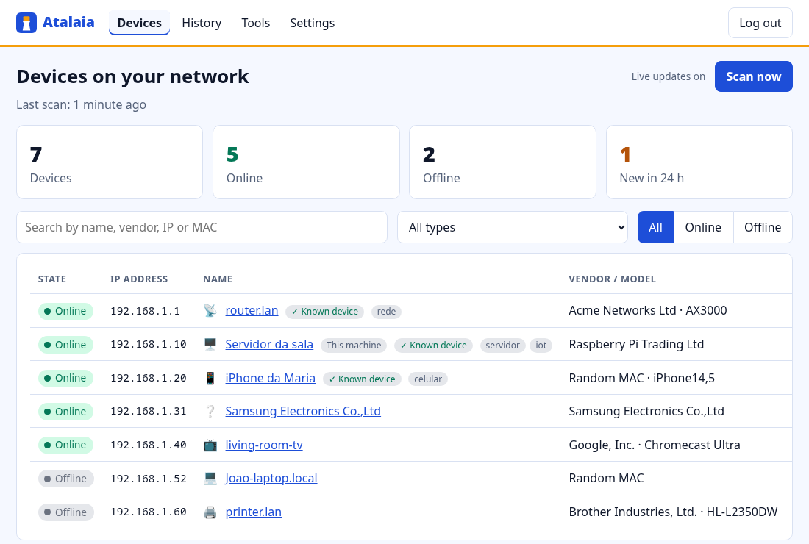

# Atalaia

**English** · [Português](README.md)

[](https://github.com/EttoreCSenatore/atalaia/actions/workflows/ci.yml)
[](LICENSE)
[](https://ettorecsenatore.github.io/atalaia/en/)

**Watch your network.** A free, open-source, self-hosted network watchtower: discover the devices on your network, track history, get alerts and run **defensive** security checks. A Go agent with the web app embedded.

> **State: v0.1 + M4.1 (ARP spoofing signs) + M5.1 (tools) + M5.2 (exposure).** `atalaia serve` discovers the devices, keeps the history, serves a web app with login (Linux, Docker) and alerts you through ntfy, Telegram, webhook or e-mail when a new device appears. See the [roadmap](https://ettorecsenatore.github.io/atalaia/en/docs/roadmap).

## Try it (Linux)

```bash
go run ./cmd/atalaia scan      # discover the devices on your network
go run ./cmd/atalaia devices   # list them
go run ./cmd/atalaia history   # what changed
go run ./cmd/atalaia serve     # web app with login at http://127.0.0.1:8080
```

With Docker: `cd deploy && docker compose up -d --build` (the setup code shows in `docker compose logs atalaia`).



## What it will do

- **Device discovery** (ARP, mDNS, SSDP) with vendor, name and type.
- **History and alerts**: online/offline timeline and new-device notifications (ntfy, Telegram, e-mail, webhook).
- **Passive and active security**: ARP spoofing, rogue DHCP, ports and services, known CVEs, TLS, exposed panels.
- **Network tools**: ping, traceroute, DNS, Wake-on-LAN, speed.

## Principles

- **Defensive**: for auditing **your own** network. Scope fixed to the host's own private networks; active checks are opt-in and logged.
- **Secure by default**: login required, LAN-only, no root, no telemetry.
- **Free software**: code AGPL-3.0-or-later ([LICENSE](LICENSE)); documentation CC BY-SA 4.0 ([LICENSE-DOCS.md](LICENSE-DOCS.md)).
- Independent project: not affiliated with Fing Limited and does not use its trademarks or data.

## Development

```bash
go run ./cmd/atalaia scope          # networks Atalaia may probe
go vet ./... && go test -race ./...
cd website && npm ci && npm start   # documentation
```

Without Go installed: `docker run --rm -v "$PWD":/src -w /src golang:1-alpine go test ./...`. See [Development](https://ettorecsenatore.github.io/atalaia/en/docs/tecnico/desenvolvimento). Vulnerabilities: [SECURITY.md](SECURITY.md).

Use only on networks you administer or have written authorization for.
