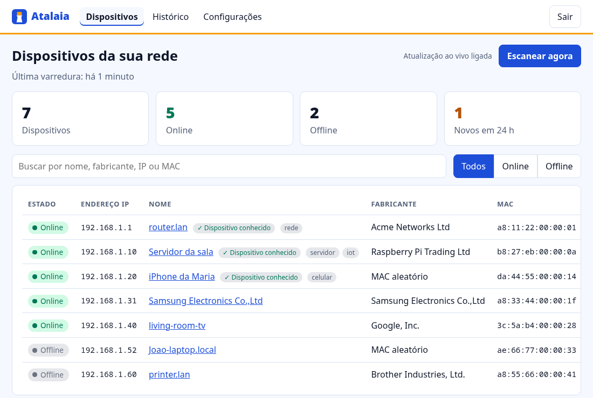

# Atalaia

[English](README.en.md) · **Português**

[](https://github.com/EttoreCSenatore/atalaia/actions/workflows/ci.yml)
[](LICENSE)
[](https://ettorecsenatore.github.io/atalaia/)

**Vigia da sua rede.** Vigia de rede livre, de código aberto e auto-hospedado: descubra os dispositivos da sua rede, acompanhe o histórico, receba alertas e faça verificações de segurança **defensivas**. Um agente em Go com o app web embutido.

> **Estado: M3 (alertas).** `atalaia serve` descobre os dispositivos, guarda o histórico, serve um app web com login (Linux, Docker) e avisa por ntfy, Telegram, webhook ou e-mail quando surge um dispositivo novo. Veja o [roadmap](https://ettorecsenatore.github.io/atalaia/docs/roadmap).

## Experimente (Linux)

```bash
go run ./cmd/atalaia scan      # descobre os dispositivos da sua rede
go run ./cmd/atalaia devices   # lista
go run ./cmd/atalaia history   # o que mudou
go run ./cmd/atalaia serve     # app web com login em http://127.0.0.1:8080
```

Com Docker: `cd deploy && docker compose up -d --build` (o código de configuração aparece em `docker compose logs atalaia`).



## O que vai fazer

- **Descoberta de dispositivos** (ARP, mDNS, SSDP) com fabricante, nome e tipo.
- **Histórico e alertas**: linha do tempo online/offline e aviso de dispositivo novo (ntfy, Telegram, e-mail, webhook).
- **Segurança passiva e ativa**: ARP spoofing, DHCP falso, portas e serviços, CVEs conhecidas, TLS, painéis expostos.
- **Ferramentas de rede**: ping, traceroute, DNS, Wake-on-LAN, velocidade.

## Princípios

- **Defensivo**: para auditar a **sua** rede. Escopo fixo nas redes privadas do próprio host, verificações ativas opcionais e registradas.
- **Seguro por padrão**: login obrigatório, só na rede local, sem root, sem telemetria.
- **Software livre**: código AGPL-3.0-or-later ([LICENSE](LICENSE)); documentação CC BY-SA 4.0 ([LICENSE-DOCS.md](LICENSE-DOCS.md)).
- Projeto independente: sem ligação com a Fing Limited nem uso das suas marcas ou dados.

## Desenvolvimento

```bash
go run ./cmd/atalaia scope          # redes que o Atalaia pode sondar
go vet ./... && go test -race ./...
cd website && npm ci && npm start   # documentação
```

Sem Go instalado: `docker run --rm -v "$PWD":/src -w /src golang:1-alpine go test ./...`. Veja [Desenvolvimento](https://ettorecsenatore.github.io/atalaia/docs/tecnico/desenvolvimento). Vulnerabilidades: [SECURITY.md](SECURITY.md).

Use só em redes que você administra ou em que tem autorização por escrito.
