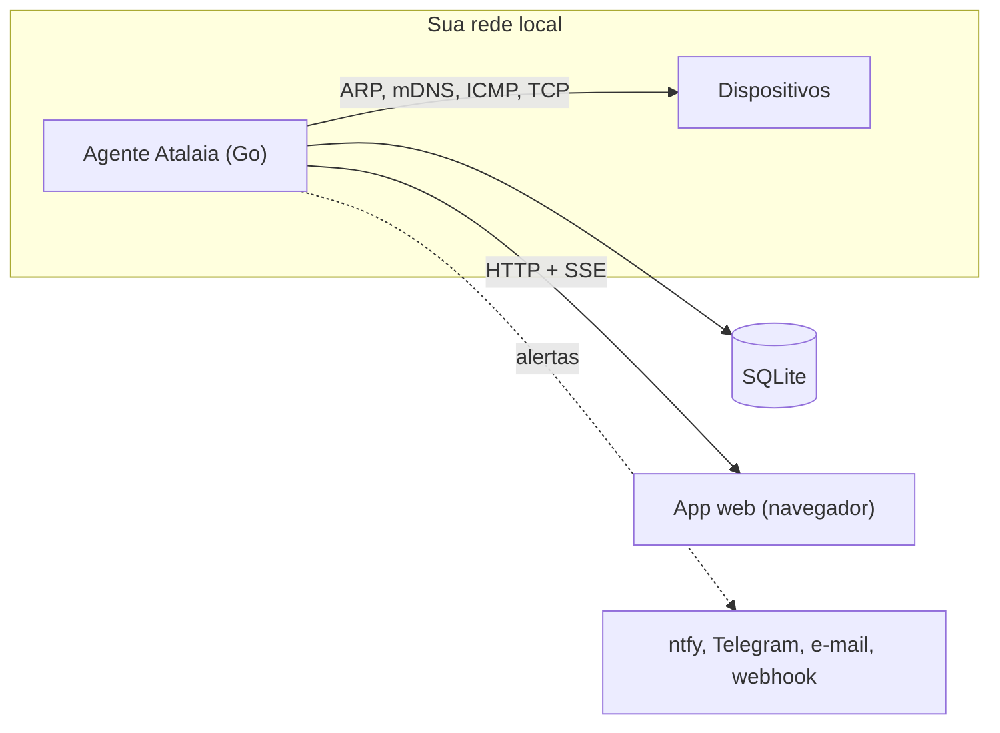

# Arquitetura

## Visão geral

- **Agente**: um binário em Go que descobre dispositivos, guarda o histórico, roda as verificações e serve a API e o app web.
- **App web**: arquivos estáticos embutidos no binário (`go:embed`). Atualizações ao vivo por SSE.
- **Armazenamento**: SQLite, um único arquivo na máquina do usuário.

## Por que um agente

O navegador não tem sockets brutos, ARP, ICMP nem mDNS. O agente roda **sem root e sem capacidades** (a descoberta usa só UDP e a tabela ARP do sistema; a verificação de DHCP, opcional, é a única que pede `CAP_NET_BIND_SERVICE`) e é o único componente que toca a rede.

## Componentes

| Pacote | Responsabilidade |
|---|---|
| `internal/scope` | Quais endereços podem ser sondados (só redes privadas do próprio host) |
| `internal/discovery` | Varredura UDP + tabela ARP do sistema, rotas, o próprio host |
| `internal/fingerprint` | O que o dispositivo diz que é: serviços e modelo mDNS, UPnP (SSDP), NetBIOS, e o palpite de tipo |
| `internal/names`, `internal/identity` | Nomes (mDNS, DNS reverso), fabricante por MAC (IEEE) e limpeza de textos vindos da rede |
| `internal/probe` | Uma passada de descoberta completa, uma observação por MAC |
| `internal/store` | SQLite, migrações, histórico, detecção de sinais de ARP spoofing, auditoria |
| `internal/monitor` | Varredura agendada, eventos ao vivo |
| `internal/api`, `internal/auth` | API HTTP, login (argon2id), sessões, proteções do servidor, ferramentas ativas |
| `internal/tlsutil` | HTTPS embutido: certificado autoassinado com renovação ou o seu |
| `internal/alerts`, `internal/notify` | Regras de alerta e adaptadores (ntfy, Telegram, webhook, e-mail) |
| `internal/tools` | Ping, DNS, Wake-on-LAN, varredura de portas, exposição, traceroute, teste de velocidade |
| `internal/dhcpprobe`, `internal/dhcpwatch` | Verificação opcional de servidor DHCP falso |
| `internal/dhcpsniff` | Escuta opcional dos pedidos DHCP para aprender nomes |
| `internal/web` + `web/` | App web (Svelte) embutido no binário, com manifesto e service worker do app instalável (`web/pwa/`) |

## Pilha

- **Go** (um binário estático, compila para ARM).
- **SQLite** embutido.
- **Interface**: Svelte 5 + Vite + TypeScript (cerca de 25 KB comprimido), compilada para dentro do binário (`go:embed`).
- **Empacotamento**: binário por sistema, imagem Docker (`--network host`, necessário para a descoberta na camada 2) e unidade systemd.

## Fontes de dados abertas

| Fonte | Uso | Licença |
|---|---|---|
| Listas de OUI do IEEE (MA-L, MA-M, MA-S) | Fabricante pelo MAC (`scripts/atualizar-oui.py` gera `oui.tsv.gz`) | Registro público do IEEE |
| `speed.cloudflare.com` (só se você rodar o teste de velocidade) | Arquivo de teste para medir o download | Serviço de terceiro; veja [Segurança e privacidade](seguranca-e-privacidade.md) |

Não usamos bancos de vulnerabilidades (NVD, OSV) nem impressões digitais de banners: veja por que em [Ferramentas](../funcionalidades/ferramentas.md#verificação-de-cves-por-que-não-tem). Cada fonte nova é registrada aqui, com a licença verificada, antes de entrar. Fontes proprietárias não são usadas.
