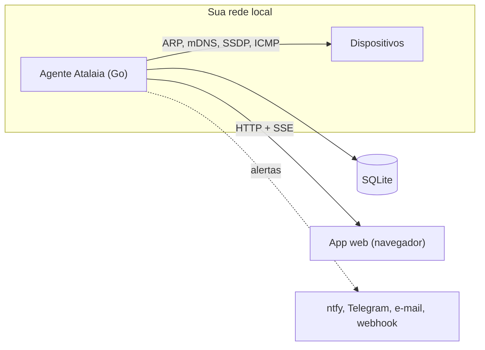

# Arquitetura

## Visão geral

- **Agente**: um binário em Go que descobre dispositivos, guarda o histórico, roda as verificações e serve a API e o app web.
- **App web**: arquivos estáticos embutidos no binário (`go:embed`). Atualizações ao vivo por SSE.
- **Armazenamento**: SQLite, um único arquivo na máquina do usuário.

## Por que um agente

O navegador não tem sockets brutos, ARP, ICMP nem mDNS. O agente roda com a permissão mínima (`CAP_NET_RAW`, sem root) e é o único componente que toca a rede.

## Componentes planejados

| Pacote | Responsabilidade | Etapa |
|---|---|---|
| `internal/scope` | Quais endereços podem ser sondados (só redes privadas do próprio host) | M0 |
| `internal/discovery` | Varredura UDP + tabela ARP do sistema (sem root) | M1 |
| `internal/names` | Nome do dispositivo: mDNS e DNS reverso | M1 |
| `internal/identity` | Fabricante por MAC (IEEE) e limpeza de textos vindos da rede | M1 |
| `internal/store` | SQLite, migrações, histórico de eventos | M1 |
| `internal/discovery` (SSDP, NetBIOS) | Mais fontes de descoberta | M2+ |
| `internal/api` | API HTTP, autenticação, SSE, proteções do servidor | M2.1 |
| `internal/auth` | Senha (argon2id), sessões, limite de tentativas | M2.1 |
| `internal/monitor` | Varredura agendada e eventos ao vivo | M2.1 |
| `internal/web` | App web embutido no binário | M2.2 |
| `internal/notify` | Adaptadores de notificação | M3 |
| `internal/detect` | Detecções passivas de segurança | M4 |
| `internal/scan` | Portas, serviços, CVEs, TLS | M5 |

## Pilha

- **Go** (um binário estático, compila para ARM).
- **SQLite** embutido.
- **Interface**: SvelteKit ou React compilado, decisão no M2.
- **Empacotamento**: binário por sistema, imagem Docker (`--network host`, necessário para a descoberta na camada 2) e unidade systemd.

## Fontes de dados abertas

| Fonte | Uso | Licença |
|---|---|---|
| Listas de OUI do IEEE (MA-L, MA-M, MA-S) | Fabricante pelo MAC (`scripts/atualizar-oui.py` gera `oui.tsv.gz`) | Registro público do IEEE |
| Tipos de serviço mDNS/DNS-SD | Tipo do dispositivo | Pública |
| Rapid7 Recog | Impressão digital de banners | BSD-2-Clause |
| NVD e OSV | CVEs | Dados públicos |

Cada fonte nova é registrada aqui, com a licença verificada, antes de entrar. Fontes proprietárias não são usadas.
