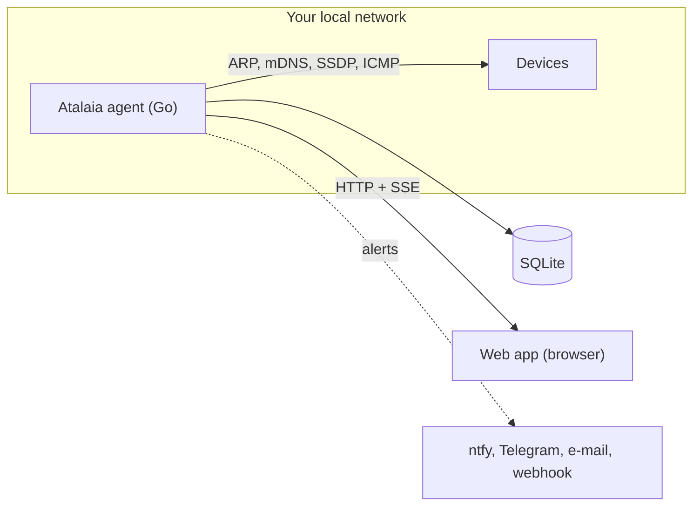

# Architecture

## Overview

- **Agent**: a Go binary that discovers devices, stores history, runs the checks and serves the API and the web app.
- **Web app**: static files embedded in the binary (`go:embed`). Live updates over SSE.
- **Storage**: SQLite, a single file on the user's machine.

## Why an agent

A browser has no raw sockets, ARP, ICMP or mDNS. The agent runs with minimal permission (`CAP_NET_RAW`, no root) and is the only component that touches the network.

## Planned components

| Package | Responsibility | Step |
|---|---|---|
| `internal/scope` | Which addresses may be probed (only the host's own private networks) | M0 |
| `internal/discovery` | UDP sweep + the system ARP table (no root) | M1 |
| `internal/names` | Device name: mDNS and reverse DNS | M1 |
| `internal/identity` | Vendor by MAC (IEEE) and sanitizing of text from the network | M1 |
| `internal/store` | SQLite, migrations, event history | M1 |
| `internal/discovery` (SSDP, NetBIOS) | More discovery sources | M2+ |
| `internal/api` | HTTP API, authentication, SSE | M2 |
| `internal/notify` | Notification adapters | M3 |
| `internal/detect` | Passive security detections | M4 |
| `internal/scan` | Ports, services, CVEs, TLS | M5 |

## Stack

- **Go** (a static binary that cross-compiles to ARM).
- Embedded **SQLite**.
- **UI**: compiled SvelteKit or React, decided in M2.
- **Packaging**: a binary per OS, a Docker image (`--network host`, required for layer-2 discovery) and a systemd unit.

## Open data sources

| Source | Use | License |
|---|---|---|
| IEEE OUI lists (MA-L, MA-M, MA-S) | Vendor from MAC (`scripts/atualizar-oui.py` builds `oui.tsv.gz`) | Public IEEE registry |
| mDNS/DNS-SD service types | Device type | Public |
| Rapid7 Recog | Banner fingerprints | BSD-2-Clause |
| NVD and OSV | CVEs | Public data |

Every new source is recorded here, with its license checked, before it is added. Proprietary sources are not used.
