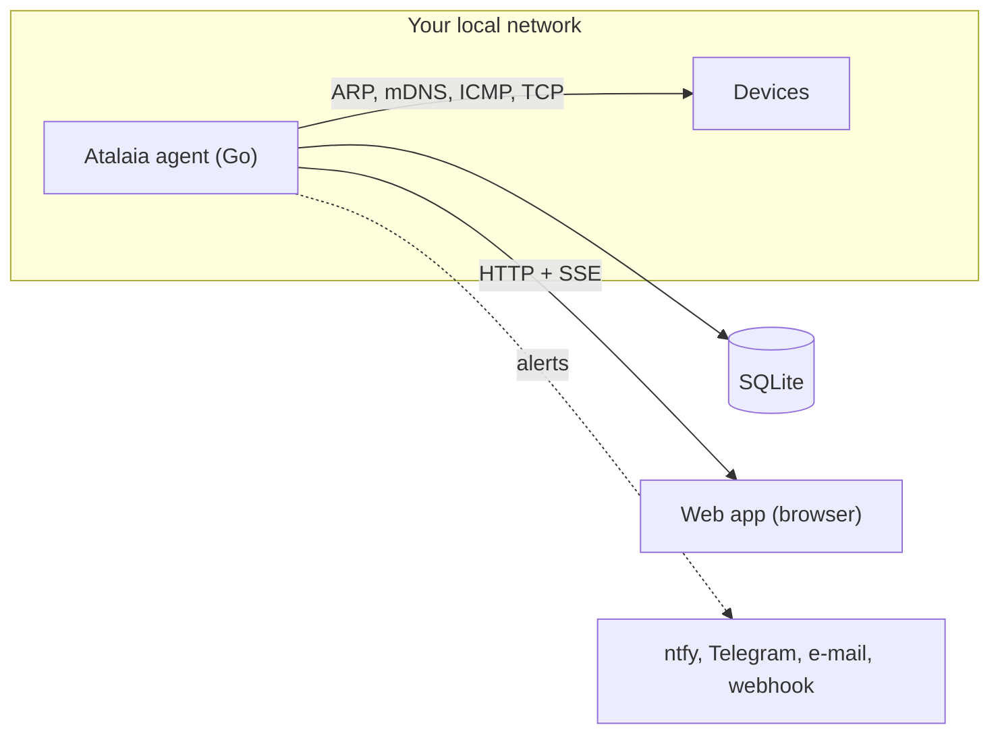

# Architecture

## Overview

- **Agent**: a Go binary that discovers devices, stores history, runs the checks and serves the API and the web app.
- **Web app**: static files embedded in the binary (`go:embed`). Live updates over SSE.
- **Storage**: SQLite, a single file on the user's machine.

## Why an agent

A browser has no raw sockets, ARP, ICMP or mDNS. The agent runs **without root and without capabilities** (discovery uses only UDP and the system ARP table; the optional DHCP check is the only thing that asks for `CAP_NET_BIND_SERVICE`) and is the only component that touches the network.

## Components

| Package | Responsibility |
|---|---|
| `internal/scope` | Which addresses may be probed (only the host's own private networks) |
| `internal/discovery` | UDP sweep + the system ARP table, routes, the host itself |
| `internal/fingerprint` | What a device says it is: mDNS services and model, UPnP (SSDP), NetBIOS, and the type guess |
| `internal/names`, `internal/identity` | Names (mDNS, reverse DNS), vendor by MAC (IEEE) and sanitizing of text from the network |
| `internal/probe` | One full discovery pass, one observation per MAC |
| `internal/store` | SQLite, migrations, history, ARP-spoofing sign detection, audit log |
| `internal/monitor` | Scheduled scans, live events |
| `internal/api`, `internal/auth` | HTTP API, login (argon2id), sessions, server protections, active tools |
| `internal/tlsutil` | Built-in HTTPS: self-signed certificate with renewal, or your own |
| `internal/alerts`, `internal/notify` | Alert rules and adapters (ntfy, Telegram, webhook, e-mail) |
| `internal/tools` | Ping, DNS, Wake-on-LAN, port scan, exposure, traceroute, speed test |
| `internal/dhcpprobe`, `internal/dhcpwatch` | Optional rogue DHCP server check |
| `internal/web` + `web/` | Web app (Svelte) embedded in the binary |

## Stack

- **Go** (a static binary that cross-compiles to ARM).
- Embedded **SQLite**.
- **UI**: Svelte 5 + Vite + TypeScript (about 25 KB gzipped), compiled into the binary (`go:embed`).
- **Packaging**: a binary per OS, a Docker image (`--network host`, required for layer-2 discovery) and a systemd unit.

## Open data sources

| Source | Use | License |
|---|---|---|
| IEEE OUI lists (MA-L, MA-M, MA-S) | Vendor from MAC (`scripts/atualizar-oui.py` builds `oui.tsv.gz`) | Public IEEE registry |
| `speed.cloudflare.com` (only if you run the speed test) | Test file to measure download | Third-party service; see [Security and privacy](seguranca-e-privacidade.md) |

We do not use vulnerability databases (NVD, OSV) or banner fingerprints: see why in [Tools](../funcionalidades/ferramentas.md#cve-checks-why-there-are-none). Every new source is recorded here, with its license checked, before it is added. Proprietary sources are not used.
